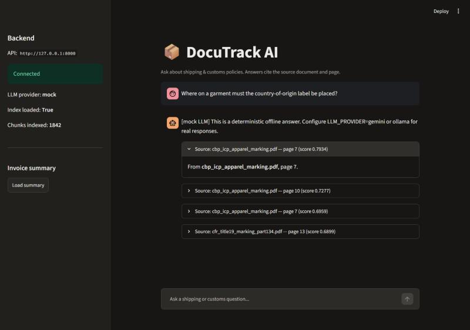
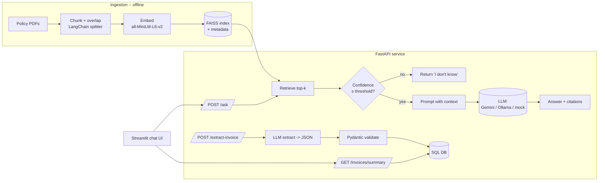

# DocuTrack AI

> A Generative-AI assistant for shipping & customs documents: ask questions
> against a library of policy PDFs and get answers **with citations**, and
> extract structured data from commercial invoices into a SQL database.

All documents in `data/docs/` are **real, public-domain U.S. government
publications** on shipping, customs and logistics — CBP importing guides and
informed-compliance publications, Census Bureau export regulations, and CFR
hazmat/marking parts. They are works of the U.S. federal government and are
therefore in the public domain (17 U.S.C. § 105); no copyrighted carrier
policies or paywalled material are used. See
[`data/docs/SOURCES.md`](data/docs/SOURCES.md) for every file's title, issuer,
page count and source URL. Every metric below is produced by running the code —
no invented numbers.

## Demo



*Streamlit UI (left: live backend status — mock provider, 1,842 chunks indexed)
answering a country-of-origin marking question. The answer text is the offline
mock LLM, but the ranked citations are real retrieval results against the
public-domain corpus — document name, page and similarity score (here, CBP's
apparel-marking and the 19 CFR Part 134 marking documents).*

---

## What it does

1. **Document Q&A (RAG).** `POST /ask` retrieves the most relevant chunks from a
   FAISS vector index of real shipping & customs PDFs and asks an LLM to answer *using
   only those chunks*, returning the source file and page for each answer. If
   retrieval confidence is low it replies **"I don't know"** instead of guessing.
2. **Invoice extraction.** `POST /extract-invoice` turns a commercial-invoice PDF
   into validated JSON (shipper, consignee, HS codes, line items, declared
   value) and stores it; `GET /invoices/summary` runs SQL aggregates over
   everything extracted. The bundled invoices in `data/invoices/` are
   **clearly-labelled fictitious samples** (every party is an obvious
   placeholder, every page carries a "SAMPLE — fictitious data" banner) used to
   exercise the extraction path without fabricating a real-looking company's
   invoice — see [`data/invoices/README.md`](data/invoices/README.md).

## Tech stack

Python 3.11 · FastAPI · LangChain (recursive text splitting) ·
sentence-transformers (`all-MiniLM-L6-v2`, 384-dim) · FAISS ·
Google Gemini / Ollama (switchable, with an offline mock) ·
SQLAlchemy + PostgreSQL/SQLite · Streamlit · Docker · GitHub Actions

## Architecture



## How to run

### Option A — local, no Docker

```bash
python -m venv .venv
.venv\Scripts\activate            # Windows  (source .venv/bin/activate on macOS/Linux)
pip install -r requirements.txt
cp .env.example .env              # then set GEMINI_API_KEY, or LLM_PROVIDER=mock / ollama

python -m scripts.fetch_docs         # download the 10 real public-domain PDFs
python -m scripts.generate_invoices  # create 5 clearly-labelled SAMPLE invoices
python -m app.ingest                 # build the FAISS index

uvicorn app.main:app --reload        # API at http://localhost:8000/docs
streamlit run ui/streamlit_app.py    # UI  at http://localhost:8501
```

With no API key you can still run everything end-to-end by setting
`LLM_PROVIDER=mock` (deterministic offline answers).

### Option B — Docker (API + Postgres + UI)

```bash
docker compose up --build
# API -> http://localhost:8000/docs   UI -> http://localhost:8501
```

On first boot the API container downloads the public-domain document corpus
(`scripts.fetch_docs`, needs network access), generates the sample invoices, and
builds the FAISS index. The PDFs are also committed under `data/docs/`, so a
checkout already has them.

## API

| Method | Path                  | Purpose                                              |
|--------|-----------------------|------------------------------------------------------|
| GET    | `/health`             | Status, active LLM provider, whether an index is loaded |
| POST   | `/ask`                | RAG answer with citations + confidence               |
| POST   | `/extract-invoice`    | PDF upload → validated invoice JSON, stored in the DB |
| GET    | `/invoices/summary`   | SQL aggregates (value by country, top HS codes)      |

## Evaluation

Retrieval quality is measured by `eval/run_eval.py` over **30 questions** with
known source documents (no LLM involved, fully deterministic):

<!-- METRICS:START -->
Measured on 2026-11-26 by running `python -m eval.run_eval` against the FAISS
index built from the **10 real public-domain documents (1,842 chunks)**:

| Metric | Value |
|--------|-------|
| Questions | 28 |
| Hit-rate@3 | 96.4% (27/28) |
| Hit-rate@5 | 96.4% (27/28) |

The single miss is instructive: *"What electronic filing replaced the paper
Shipper's Export Declaration?"* retrieves the Census **Foreign Trade
Regulations** instead of the Census **AES Quick Reference Guide** — two genuinely
overlapping export documents. That is exactly the kind of near-duplicate
retrieval error a real corpus surfaces (and the toy synthetic corpus never did).
Reproduce with `python -m eval.run_eval` (writes `eval/results.json`).
<!-- METRICS:END -->

## Tests

```bash
pytest           # offline: uses the mock LLM, no model download, no network
```

<!-- TESTS:START -->
**15 tests** pass (chunking, RAG confidence guard, invoice parsing + Pydantic
validation, and the API via FastAPI's `TestClient`). CI runs ruff + pytest on
every push — see [`.github/workflows/ci.yml`](.github/workflows/ci.yml).
<!-- TESTS:END -->

---
See [`INTERVIEW_NOTES.md`](INTERVIEW_NOTES.md) for 20 Q&As on this code and
[`RESUME_BULLETS.md`](RESUME_BULLETS.md) for résumé lines (real numbers only).
