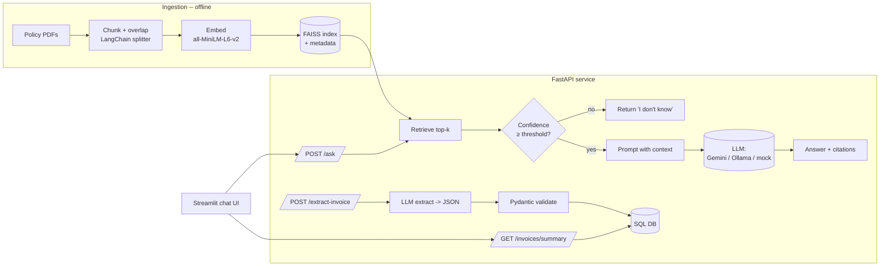

# DocuTrack AI

> A Generative-AI assistant for shipping & customs documents: ask questions
> against a library of policy PDFs and get answers **with citations**, and
> extract structured data from commercial invoices into a SQL database.

All documents in `data/docs/` are **synthetic samples** created for this
project; each carries a "Synthetic sample document" footer. No real carrier
policies are used. Every metric below is produced by running the code — no
invented numbers.

---

## What it does

1. **Document Q&A (RAG).** `POST /ask` retrieves the most relevant chunks from a
   FAISS vector index of shipping-policy PDFs and asks an LLM to answer *using
   only those chunks*, returning the source file and page for each answer. If
   retrieval confidence is low it replies **"I don't know"** instead of guessing.
2. **Invoice extraction.** `POST /extract-invoice` turns a commercial-invoice PDF
   into validated JSON (shipper, consignee, HS codes, line items, declared
   value) and stores it; `GET /invoices/summary` runs SQL aggregates over
   everything extracted.

## Tech stack

Python 3.11 · FastAPI · LangChain (recursive text splitting) ·
sentence-transformers (`all-MiniLM-L6-v2`, 384-dim) · FAISS ·
Google Gemini / Ollama (switchable, with an offline mock) ·
SQLAlchemy + PostgreSQL/SQLite · Streamlit · Docker · GitHub Actions

## Architecture



## How to run

### Option A — local, no Docker

```bash
python -m venv .venv
.venv\Scripts\activate            # Windows  (source .venv/bin/activate on macOS/Linux)
pip install -r requirements.txt
cp .env.example .env              # then set GEMINI_API_KEY, or LLM_PROVIDER=mock / ollama

python -m scripts.generate_docs      # create the 10 synthetic policy PDFs
python -m scripts.generate_invoices  # create 5 synthetic invoices
python -m app.ingest                 # build the FAISS index

uvicorn app.main:app --reload        # API at http://localhost:8000/docs
streamlit run ui/streamlit_app.py    # UI  at http://localhost:8501
```

With no API key you can still run everything end-to-end by setting
`LLM_PROVIDER=mock` (deterministic offline answers).

### Option B — Docker (API + Postgres + UI)

```bash
docker compose up --build
# API -> http://localhost:8000/docs   UI -> http://localhost:8501
```

The API container bootstraps sample data and the index on first boot.

## API

| Method | Path                  | Purpose                                              |
|--------|-----------------------|------------------------------------------------------|
| GET    | `/health`             | Status, active LLM provider, whether an index is loaded |
| POST   | `/ask`                | RAG answer with citations + confidence               |
| POST   | `/extract-invoice`    | PDF upload → validated invoice JSON, stored in the DB |
| GET    | `/invoices/summary`   | SQL aggregates (value by country, top HS codes)      |

## Evaluation

Retrieval quality is measured by `eval/run_eval.py` over **30 questions** with
known source documents (no LLM involved, fully deterministic):

<!-- METRICS:START -->
Measured on 2025-11-26 by running `python -m eval.run_eval` against the FAISS
index built from the 10 synthetic documents (21 chunks):

| Metric | Value |
|--------|-------|
| Questions | 30 |
| Hit-rate@3 | 100.0% (30/30) |
| Hit-rate@5 | 100.0% (30/30) |

The perfect score reflects a small, topically-distinct corpus; on a larger,
overlapping corpus this is where chunking and embedding tuning would earn their
keep. Reproduce with `python -m eval.run_eval` (writes `eval/results.json`).
<!-- METRICS:END -->

## Tests

```bash
pytest           # offline: uses the mock LLM, no model download, no network
```

<!-- TESTS:START -->
**15 tests** pass (chunking, RAG confidence guard, invoice parsing + Pydantic
validation, and the API via FastAPI's `TestClient`). CI runs ruff + pytest on
every push — see [`.github/workflows/ci.yml`](.github/workflows/ci.yml).
<!-- TESTS:END -->

---
See [`INTERVIEW_NOTES.md`](INTERVIEW_NOTES.md) for 20 Q&As on this code and
[`RESUME_BULLETS.md`](RESUME_BULLETS.md) for résumé lines (real numbers only).
